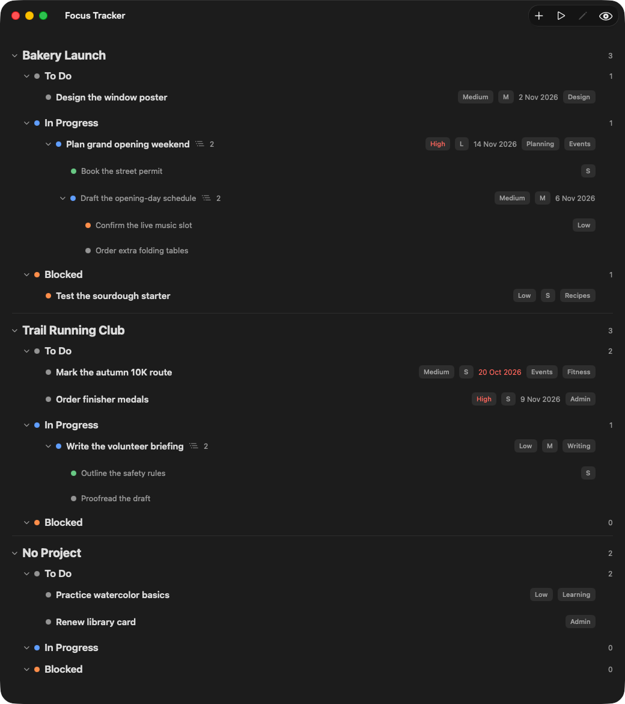
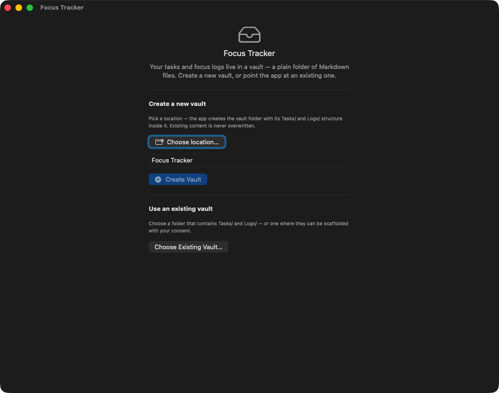
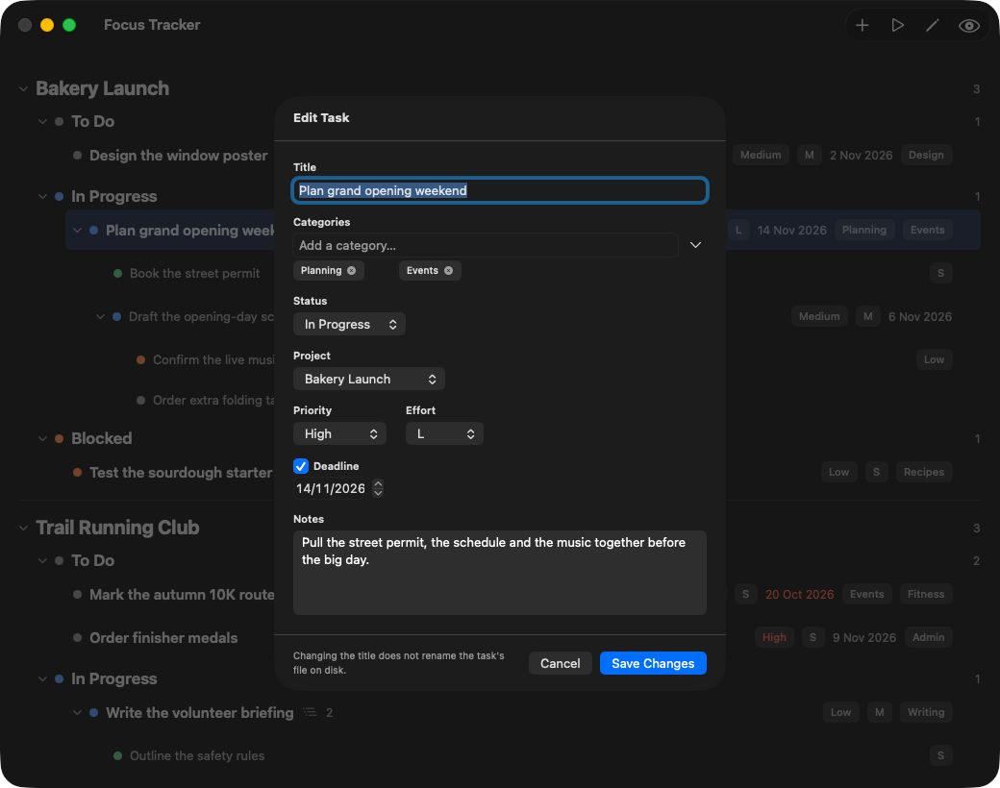
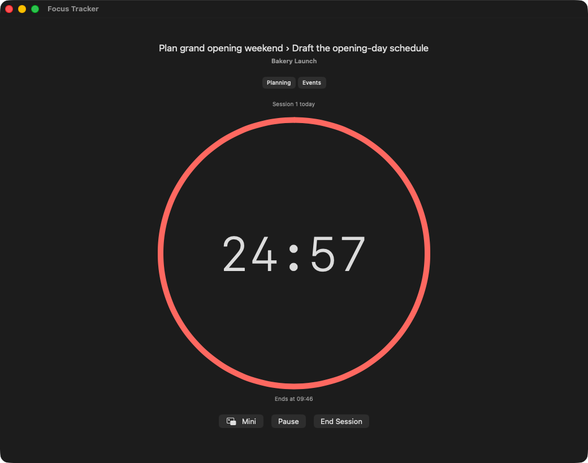
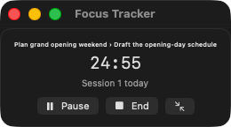
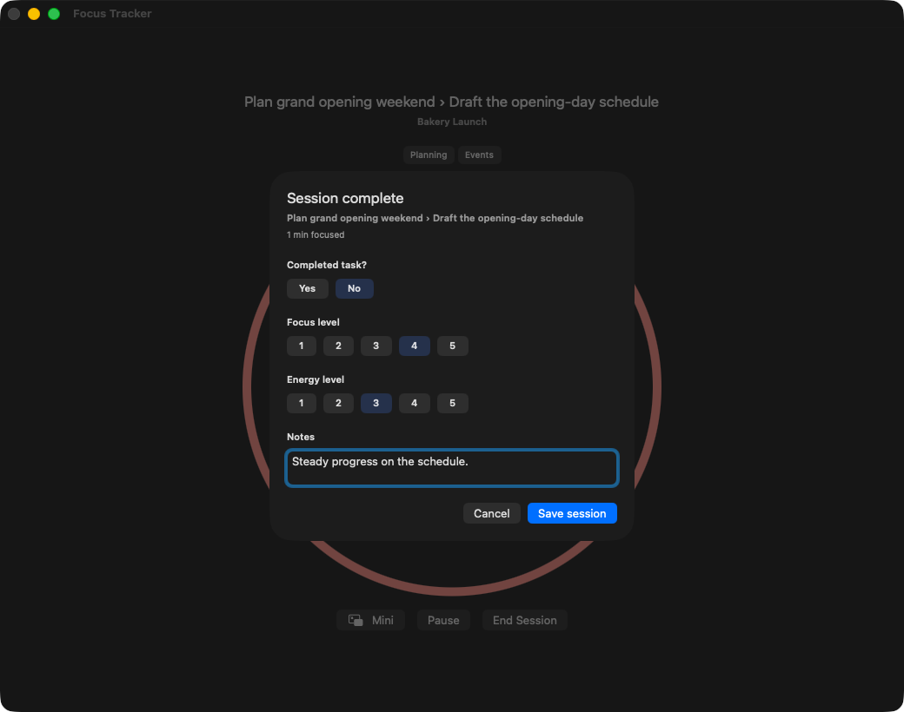

# Focus Tracker

**[Download for Mac](https://github.com/rileycong/focus-tracker/releases/latest/download/FocusTracker.dmg)**

The green Code button and the Source code downloads are for programmers; to use the app, choose Download for Mac above.

A small, native Mac app for keeping a task list and timing your focus
sessions. Your tasks and session history live as plain Markdown files in a
folder you choose — which can be an [Obsidian](https://obsidian.md) vault — so
your data stays yours, readable, and portable.

## Requirements

macOS 14 (Sonoma) or later, on an Apple Silicon or Intel Mac (a universal app).

## Download and first launch

Focus Tracker is free and open source, ad-hoc signed (not a paid Developer ID
certificate), and not notarized. Approval is needed on first launch and may be
needed again after an update.

1. Download via **Download for Mac** above.
2. Double-click `FocusTracker.dmg`.
3. Drag **Focus Tracker** to **Applications** in the image.
4. Eject the image using Finder's sidebar eject button.
5. Open **Focus Tracker** from Applications.

### macOS 14 (Sonoma)

1. If macOS blocks the app, close the warning.
2. Control-click (or right-click) Focus Tracker in Applications.
3. Choose Open.
4. Click Open in the confirmation.
5. If Open is not offered, use the System Settings steps below.

### macOS 15 (Sequoia) or later, including macOS 26

1. Close the warning with Done (or OK, if shown).
2. Open System Settings.
3. Click Privacy & Security.
4. Scroll to Security.
5. Click Open Anyway beside the message about Focus Tracker.
6. Authenticate with your password or Touch ID if asked.
7. Click Open in the confirmation.

Warning text can vary by macOS version and language. Only approve the app if you
trust its source. If Open Anyway is missing, try opening the app once more and
return here; a managed Mac may require your administrator's help.
See [Apple's guidance](https://support.apple.com/en-us/102445).
A damaged-app or malware warning is a reason to stop, not bypass security.
These directions are documentation, not a claim that every OS flow was tested.

## First run

Choose **Create a new vault** for a fresh folder, or **Choose Existing Vault…**
to use a folder you already have (such as an Obsidian vault).

- **Create a new vault:** **Choose location…**, then **Create Vault** (disabled
  until you choose a location). It creates `Tasks/` and `Logs/`, never overwrites.
- **Choose Existing Vault…:** a folder that has `Tasks/` and `Logs/`; if they
  are missing it asks first: **Scaffold missing folders** or **Cancel**.
- **Later:** **Vault → Change Vault…** (⌘⇧V); not during a session or break.

## Tasks and subtasks

The main window groups tasks by project. Top right: **New Task** (⌘N), **Start
Session**, **Edit** (⌘E, needs a selected row) and **Show completed/dropped**
(Done and Dropped tasks stay hidden until you click it; not remembered).

- **Add or edit:** **New Task**, or select a row and **Edit** (or right-click →
  **Edit Task…**): Title, Categories, Status, Project, Priority, Effort,
  Deadline, Notes; then **Create Task** / **Save Changes**, or **Cancel**.
- **Subtasks:** right-click a task → **Add Subtask…**.
- **Status:** To Do, In Progress, Blocked, Dropped or Done, set with the
  **Status** menu. **Completed task?** → **Yes** at session end marks it Done.
- **Order:** drag a row, or right-click → **Move Up** / **Move Down**.
- **Delete:** right-click → **Delete Task…** (or the hover trash can) removes the
  task's file and subtasks **permanently — there is no Trash**; `Logs/` is
  untouched. The confirmation's "Deleted tasks stay recoverable in your GitHub
  backup." holds only if backup was on and had pushed (see below); otherwise
  only your own backups (such as Time Machine) can help.

## Projects

A project is just a name on a task. Right-click the project name →
**Rename Project…** (not offered for **No Project**), type the new name in
"Project Name" and click **Rename**; it is rewritten into every task of that
project. Projects are in name order, **No Project** last.

## Focus sessions

Click **Start Session**, or right-click a To Do or In Progress task → **Start
Session…**. Choose **Pick a task** (search "Search tasks…") or **New ad-hoc
task** (a title and a category), keep "Duration (min):" at 25 or change it, and
click **Start**.

### The timer

A red ring shows the time left, with "Session N today" and "Ends at" the
finishing time. Buttons: **Mini**, **Pause** (then **Resume**), **End Session**.

### The mini timer

**Mini** shrinks it to a small always-on-top card with **Pause** / **Resume** and
**End**. Click the arrow or the time to restore the full window.

### Ending a session

**End Session** asks "End this session?" (**End Session** or **Cancel**); the
session is paused meanwhile. If the timer reaches zero while Focus Tracker is in
front, you go straight to the wrap-up form; otherwise it beeps and shakes until
you come back. The time logged stops when the timer ended. The "Session
complete" form asks **Completed task?** (Yes/No), **Focus level** and **Energy
level** (1–5), and **Notes**. **Save session** turns on once Yes/No and both
ratings are set; **Cancel** resumes the session and logs nothing. Saved sessions
go into that day's file in `Logs/`.

## Breaks

After saving, "Session logged" / "What's next?": **Start Next Session**,
**Take Break** (the "Break: 5 min" stepper sets 1–60 minutes) or **Back to
Tasks**. The break screen has **Mini** and **End break early**; a finished break
says "Break finished — head back when you're ready." It is logged when it ends.

## If the app closes during a session

The session is saved about once a second and on quit. After a quit or crash the
next launch shows "Unfinished session" with **Resume session** and **Discard
session…**. Time while the app was closed is not counted; discarding is
permanent. **Breaks are not recovered:** quitting during a break loses it.

## Where your data lives

Plain Markdown files in your vault: `Tasks/` (one file per task, subtasks inside
their parent) and `Logs/YYYY-MM-DD.md` (sessions and breaks, one file per day).
Your other notes are never touched. Markdown drafts you drop in an `Inbox/`
folder become tasks (their text is kept in the task's file); each draft is
removed once imported. The folder is read when the app opens (and when you
switch vaults), so edits made elsewhere show up after you reopen it; a task
changed on disk after it was loaded is not overwritten (saving it is refused).

No telemetry, no analytics, and no networking by the app itself. The only outside
programs it runs are `git` (only for the optional backup below) and, if you use
AeroSpace, its command-line tool (see [DEVELOPMENT.md](DEVELOPMENT.md)).

## Optional: back up your vault to GitHub

Optional GitHub backup needs Apple's free Command Line Tools (or Xcode); tasks and timers work without them.

Sync is **off by default**; with it off Focus Tracker never runs `git`. Turn it
on in **Vault → Sync Vault…**. You need a vault that is **already a git
repository** (the app never runs `git init`), a GitHub repository of your own
(there is **no default repository**; the link field starts empty), git tools
with `user.name` and `user.email` set, and
**working SSH access to GitHub**. Paste an `https://github.com/<owner>/<repo>`
or `git@github.com:<owner>/<repo>.git` link; the SSH form is always used (HTTPS
tokens and credential helpers do not apply; GitHub only).

When the other backup requirements are met, until a link is entered, switching
sync on only shows "Sync unavailable — no
sync remote is configured." and runs no `git` command. With a link, it sets or
replaces your vault's `origin`; no token, no `gh`, no stored credentials. It
stages only `Tasks/` and `Logs/`, commits "FocusTracker vault sync", pushes about
a minute after a change and on quit, and pulls (fast-forward only) at launch and
before an Inbox import and every 15 minutes. Problems never interrupt you; the sheet shows a status line.

## Questions and troubleshooting

- **The window did not appear.** Quit from the Dock (right-click → Quit), reopen.
- **macOS says the app cannot be verified.** See "Download and first launch".
- **My tasks are not where I expected.** The **Vault** menu shows "Current: …";
  **Change Vault…** picks another.
- **A file I edited elsewhere did not change.** Quit and reopen the app.

## Uninstall

Quit Focus Tracker and delete `/Applications/Focus Tracker.app`. Optionally run
`defaults delete com.chauanhcong.FocusTracker` and delete
`~/Library/Application Support/FocusTracker`. Your vault is never removed.

## License

[MIT](LICENSE). Contributions are welcome via issues and pull requests.

Building it yourself or contributing? See [DEVELOPMENT.md](DEVELOPMENT.md).
